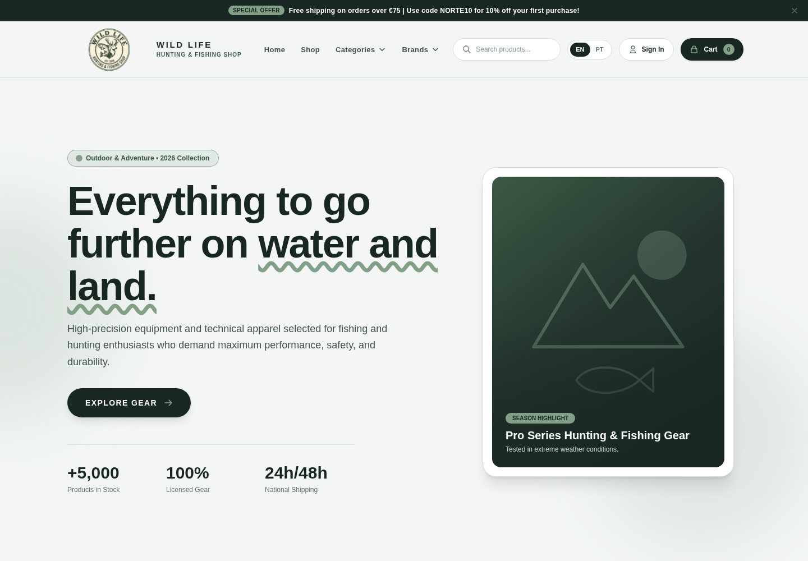
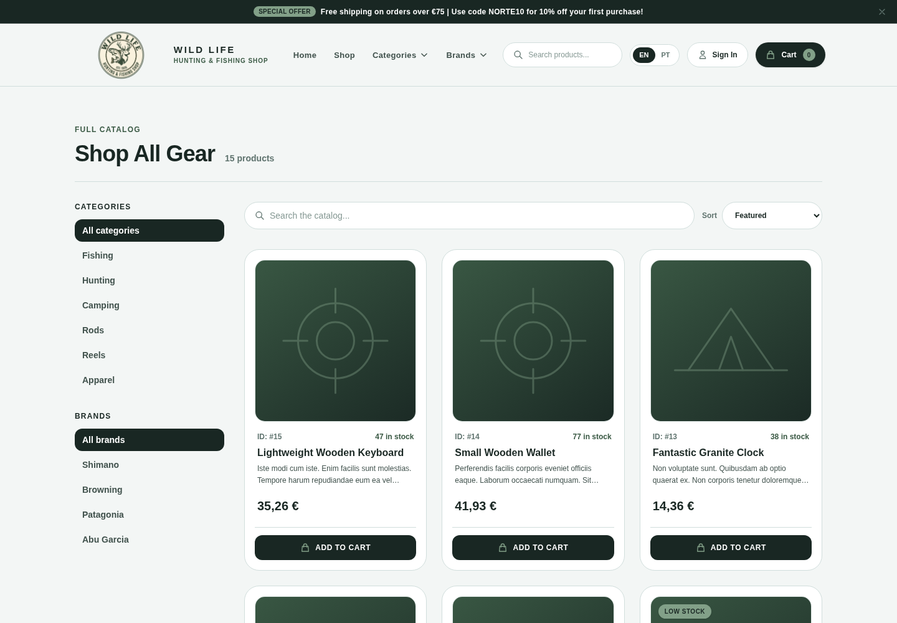
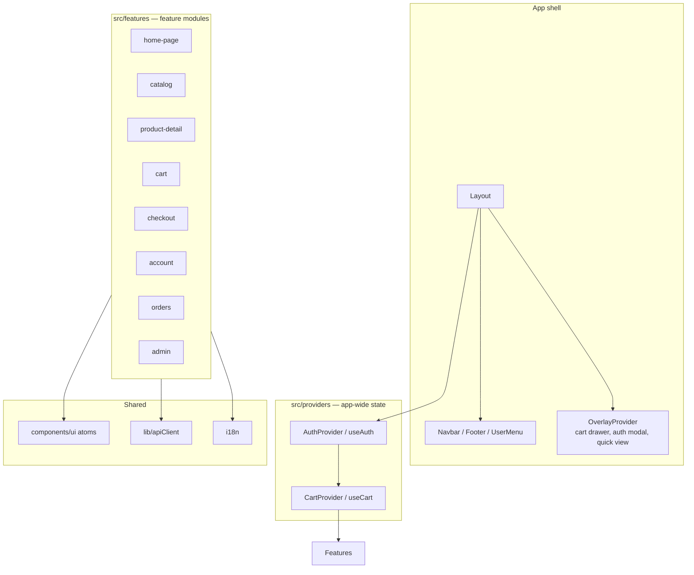

# Wild Life — Hunting & Fishing Store

[](https://github.com/tiagofsps/hunting-fishing-store-web/actions/workflows/ci.yml)


**Wild Life** is the storefront for the Hunting & Fishing Store: a React single-page
app for a regulated sporting-goods retailer. It covers the whole customer journey —
catalog, cart, checkout with licence verification, payments, account and order
history — plus a complete admin console.

It is a **proprietary portfolio project**, published so reviewers can read the code.
The API lives in a separate repository,
[hunting-fishing-store](https://github.com/tiagofsps/hunting-fishing-store).



## About this project

Hunting and fishing gear is regulated: some products require a licence, some ship
with legal notices, and prices change with promotions and coupons. The app has to
be honest about all of that while staying fast and pleasant to use.

What is interesting here, beyond the usual storefront work:

- **Licence enforcement at checkout.** A cart containing regulated items collects
  the missing hunting or fishing licence before payment, and the UI explains why.
- **Bilingual content, not just bilingual chrome.** The interface is English and
  Portuguese, and product and category text is translated per locale with the
  canonical value as fallback.
- **A hybrid cart.** Guests get a local cart; signing in merges it into the server
  cart exactly once, with server quantities winning.
- **An admin console that mirrors the backend rules.** Order transitions are
  limited to the states the API allows, and the forms send only the fields the
  backend validates as optional.

Scope: frontend only. There is no server-side rendering, no native app and no
payment SDK — payments redirect to the URL the API returns.

## Features

| Area | What it does |
|---|---|
| Home | Hero, featured carousel, brand strip, newsletter signup, quick view |
| Catalog | Search, category and brand filters, sorting, pagination, product detail with variants and stock state |
| Auth | Sign in, registration, password reset, session restore, user menu |
| Cart | Guest cart in `localStorage`, server sync when signed in, free-shipping progress |
| Checkout | Address selection or creation, licence collection, payment method, coupon, receipt with instructions |
| Account | Profile, address book, password change |
| Orders | History and a detail view with payment instructions |
| Admin | Dashboard, products, categories, brands, stock movements, orders, coupons, promotions, newsletter, users |



## Architecture



Rules, enforced by `src/architecture.test.ts`:

- a **feature never imports another feature**;
- app-wide session and cart state lives in `src/providers/`, which may import a
  feature's `api`, `validation` and `types` modules only;
- shared UI lives in `src/components/` (form atoms in `components/ui/`).

See [docs/architecture/frontend-structure.md](docs/architecture/frontend-structure.md)
for the full conventions.

## Tech stack

| Concern | Choice |
|---|---|
| UI | React 19, React Router 8 |
| Language | TypeScript 6 (`verbatimModuleSyntax`, `erasableSyntaxOnly`) |
| Build | Vite 8 |
| Styling | Tailwind CSS v4 with semantic theme tokens |
| Forms | react-hook-form + zod 4 |
| State | React context in `src/providers/` |
| Tests | Vitest 5, Testing Library, MSW |

## Quickstart

The app needs the API. Start the backend first:

```bash
git clone git@github.com:tiagofsps/hunting-fishing-store.git
cd hunting-fishing-store
docker compose up -d            # PostgreSQL + Redis
./mvnw spring-boot:run          # API on http://localhost:8080, seeds demo data
```

Then the storefront:

```bash
git clone git@github.com:tiagofsps/hunting-fishing-store-web.git
cd hunting-fishing-store-web
pnpm install
pnpm dev                        # http://localhost:5173
```

The dev server proxies `/api`, `/images`, `/brands`, `/uploads` and `/static` to
`http://localhost:8080`, so there is no CORS setup to do.

### Demo accounts

Seeded by the backend on an empty database:

| Account | Email | Password |
|---|---|---|
| Admin | `admin@huntingfishing.com` | `Password123!` |
| Shopper | `user@huntingfishing.com` | `Password123!` |

Sign in as the admin and open `/admin` for the console.

## Testing

```bash
pnpm test            # 414 tests
pnpm test:coverage   # enforces 90% lines/statements and 80% branches
pnpm typecheck
pnpm lint
```

Coverage at the 1.0.0 snapshot: **93.6% lines, 91.2% statements, 81.3% branches,
87.9% functions**.

The suite is layered: pure units and schemas, API contract tests that assert the
method, path and body of every request, hook and provider behaviour, component
tests driven by user events, and a few routed flows through the real providers.
HTTP is mocked with MSW, so no backend is needed.

See [docs/testing.md](docs/testing.md) for the harness and conventions.

## Documentation

- [Frontend structure and conventions](docs/architecture/frontend-structure.md)
- [Testing guide](docs/testing.md)
- [Changelog](CHANGELOG.md)

## License / Usage

This repository is **not open source**. It is published for portfolio and review
purposes only; no permission is granted to use, copy, modify or distribute the
code without written permission. See [LICENSE](LICENSE) and
[SECURITY.md](SECURITY.md).
